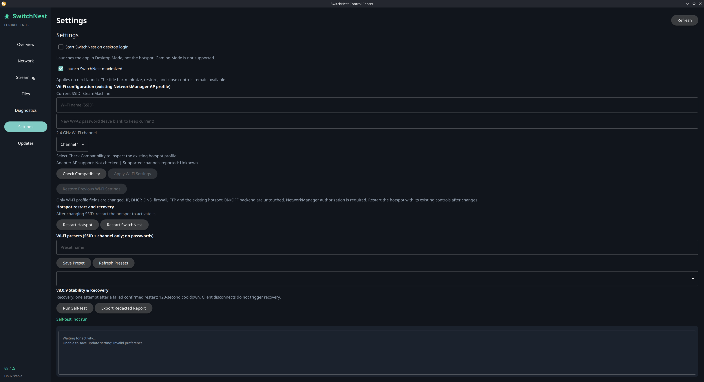
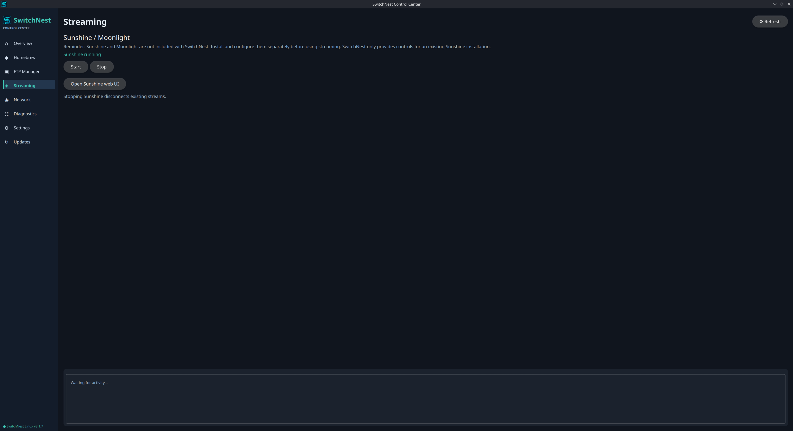

# SwitchNest (Offline Hotspot + Homebrew Manager)

**A simple way to connect your Nintendo Switch 2 to a SteamOS PC, transfer files, and manage homebrew.**

*Connect locally. Play freely.*

[](https://github.com/blueshockz47/SwitchNest-Hotspot/releases/tag/v8.1.6)  [](LICENSE)

### [Download SwitchNest v8.1.6 (Linux ZIP)](https://github.com/blueshockz47/SwitchNest-Hotspot/releases/download/v8.1.6/SwitchNest-Hotspot-Linux-v8.1.6.zip)

[**Install in 3 steps**](#install-on-steamos) · [Features](#what-can-switchnest-do) · [Screenshots](#screenshots--v815) · [Use without hotspot](#use-ftp-and-homebrew-manager-on-your-home-network) · [Troubleshooting](#troubleshooting)

SwitchNest includes an **offline Wi-Fi hotspot**, **FTP File Manager**, **Homebrew Manager**, and **Sunshine controls**. You can start the offline hotspot **without Ethernet or internet** once everything is installed.

**Already have your PC and Switch 2 on the same home network?** You can use FTP and Homebrew Manager **without starting the SwitchNest hotspot**. Local FTP can also work with **90DNS** configured on the Switch 2, provided the devices can reach each other. Downloading homebrew releases from GitHub still needs internet on the PC.

> **Note:** The hotspot is designed to keep the Switch 2 offline, but verify your firewall isolation. SwitchNest does not jailbreak your console or install kaiHEN.

## What can SwitchNest do?

| Feature | Description |
| --- | --- |
| **Offline Wi-Fi hotspot** | Connect your Switch 2 locally without sharing internet; Ethernet/LAN is **not required** to start the hotspot. |
| **FTP File Manager** | Transfer files with a compatible Switch 2 FTP server over the SwitchNest hotspot **or any reachable shared local network**, including setups using 90DNS. |
| **Switch 2 Homebrew Manager** | Browse curated homebrew releases, download eligible files, and install supported verified NRO files over FTP with confirmation; **the SwitchNest hotspot is optional**. |
| **Sunshine / Moonlight** | Start or stop an existing Sunshine service and open its web interface for local game streaming. |
| **Wi-Fi settings** | Manage the hotspot SSID, WPA2 password, channel, and saved presets using the existing backend. |
| **Status and recovery** | View hotspot/DNS status, connected Wi-Fi stations, diagnostics, and restart controls. |
| **Updates and rollback** | Update the Control Center and return to a previous managed installation when available. |

**Homebrew safety:** Catalog entries are not automatically approved for installation. A compatible release with a verifiable SHA-256 digest is required for supported downloads. Some apps need additional setup or manual installation. ZIP files are download-only in the stable Homebrew Manager.

## Screenshots — SwitchNest Linux

**Overview — hotspot status and network diagnostics**


| Homebrew Manager | FTP File Manager |
| --- | --- |
|  |  |
| Browse homebrew releases and supported installation options | Transfer files to and from a compatible Switch 2 FTP server |

| Wi-Fi Settings | Streaming |
| --- | --- |
|  |  |
| Configure hotspot Wi-Fi and recovery controls | Manage a separately installed Sunshine server |

## Install on SteamOS

**Supported target:** SteamOS in KDE Desktop Mode, with NetworkManager and a Wi-Fi adapter that supports access-point (AP) mode. You need administrator access for hotspot setup. Other Linux distributions and Windows are not confirmed for this Linux release.

**Before you start:** Download and install dependencies while your PC has internet. After setup, the offline hotspot can start **without Ethernet/LAN or internet**. Ethernet is optional if you want the PC online while its Wi-Fi adapter hosts the Switch 2 network.

### Step 1 — Download and extract

1. **[Download the stable v8.1.6 Linux ZIP](https://github.com/blueshockz47/SwitchNest-Hotspot/releases/download/v8.1.6/SwitchNest-Hotspot-Linux-v8.1.6.zip)** — use the stable release package rather than a development branch ZIP.
2. Open **Downloads** and extract the ZIP.
3. Open the extracted folder. Find the folder containing `install-switchnest-v8.sh` and `install-switchnest-pico-connectivity-v7.1-password.sh`.
4. Right-click inside that folder and choose **Open Terminal Here** (Konsole). **Run all commands below from this folder.**

### Step 2 — Install the hotspot components (first-time setup)

If you already have the working v7.1 hotspot backend and privileged helper installed, **skip to Step 3**.

**A. Install the hotspot backend:**

```bash
sudo bash ./install-switchnest-pico-connectivity-v7.1-password.sh
```

Select **Install/update hotspot**, then set up **WPA2-Personal** and your Wi-Fi password. A new installation normally uses SSID `SteamDeck-Switch2`; existing setups may use a different SSID.

**B. Install the hotspot control helper:**

```bash
sudo bash ./install-switchnest-plasma67-panel-toggle.sh
```

This helper allows the Control Center to manage the hotspot. The KDE taskbar toggle itself is optional.

**Add the SwitchNest toggle to your KDE taskbar (Plasma panel):**

1. **Right-click** an empty area of the bottom taskbar and choose **Enter Edit Mode**.
2. Select **Add Widgets**.
3. Search for **SwitchNest Hotspot Toggle**.
4. **Drag the widget onto your taskbar**, then exit Edit Mode.
5. Click the new Wi-Fi/hotspot icon to turn the offline hotspot **ON** or **OFF**. Turning it off attempts to restore your home Wi-Fi.

**Can't find the widget?** Log out and back into **Desktop Mode**, then open **Add Widgets** and search again. The widget is separate from KDE's built-in Networks icon; the installer does not modify the default network applet.

### Step 3 — Install and open SwitchNest

**Run this as your normal user — do not use `sudo`:**

```bash
bash ./install-switchnest-v8.sh
```

When the installer finishes, open **SwitchNest Control Center** from the KDE application launcher. Alternatively:

```bash
~/.local/share/switchnest/launch
```

### Connect your Switch 2 (offline hotspot mode)

1. In SwitchNest **Overview**, start the hotspot.
2. On the Switch 2, join the configured Wi-Fi network.
3. Use **automatic IP and DNS** unless your setup requires manual values.
4. Check **Connected Wi-Fi stations** in SwitchNest.

**No Ethernet cable needed.** The console's hotspot connection is intended for local services, not Nintendo online play. If you only want FTP/Homebrew Manager over your existing router, follow the next section instead.

## Use FTP and Homebrew Manager on your home network

You can leave the SwitchNest offline hotspot **OFF** and use your existing home network instead:

1. Connect your PC and Switch 2 to the **same local network** (for example, PC on router Ethernet and Switch 2 on router Wi-Fi, or both on the same Wi-Fi).
2. Start a compatible **FTP server on the Switch 2** and note its IP address and port.
3. Open SwitchNest's **FTP File Manager** or **Homebrew Manager**, enter that IP and port, and connect. For Homebrew Manager, choose a supported NRO installation workflow when available.
4. If the Switch 2 uses **90DNS**, you can keep it configured: DNS filtering does not inherently prevent local FTP traffic. Make sure the router, client isolation, firewall, and console network configuration permit devices to reach each other.

**No SwitchNest hotspot or Ethernet cable is required for these file-management features.** The PC still needs internet access to fetch new GitHub homebrew releases, and the console must have a compatible FTP server running. A 90DNS configuration is **not** a guarantee of blocking all Nintendo services or of network security.

## Homebrew Manager: download and install

1. Open **Homebrew Manager** in SwitchNest.
2. Use **Search** or the category filter to find an app.
3. **Right-click** an app card. Choose **View GitHub Repository**, **Download Only**, or **Download & Install**, depending on the available release and app requirements.
4. For **Download Only**, select an eligible verified release file and follow the project's installation instructions.
5. For **Download & Install**, first start a compatible FTP server on your Switch 2, enter the IP address and port shown on the console, and select **Connect**.
6. Choose an eligible **verified single-file NRO** release, review the destination and confirmation prompt, then approve the FTP transfer. Supported NRO installs target `/switch/`.
7. If an app requires a ZIP, plugin, extra files, or special setup, use the project's manual instructions instead of assuming a one-click installation will work.

**Example FTP connection:** `10.42.60.99` on port `1337` (from the maintainer's setup). Your console's IP and FTP port may be different.

> **Homebrew discovery in v8.1.6:** Check Now discovers GitHub/Reddit listings, groups apps by category, and caches release metadata. NRO installation requires explicit user confirmation and a compatible FTP connection; ZIP releases remain manual downloads.

## FTP File Manager and streaming

**FTP:** The SwitchNest hotspot is optional: use any reachable shared local network, including a network where the Switch 2 has 90DNS configured. Launch a compatible FTP server on the Switch 2 (for example, OunceShell), open **FTP File Manager**, enter the server IP and port, and click **Connect**. Browse the local and remote panels to manage transfers.

**Streaming:** Install and configure [Sunshine](https://github.com/LizardByte/Sunshine) on your PC and a compatible Moonlight client on your Switch 2. Open SwitchNest's **Streaming** page to control Sunshine. [Detailed streaming guide](docs/SUNSHINE.md).

## Troubleshooting

| Issue | Try this |
| --- | --- |
| **Installer says file not found** | Open Konsole in the extracted folder containing the `.sh` files, not in Downloads or another directory. |
| **Switch 2 cannot see hotspot** | Check that your Wi-Fi adapter supports AP mode, and confirm the hotspot SSID and status in SwitchNest. |
| **Hotspot has no internet** | Expected: it is an **offline** hotspot. Ethernet is not required to start it. |
| **FTP cannot connect** | Start the FTP server on the Switch 2; confirm the correct IP/port and that both devices can reach each other. |
| **Using 90DNS with FTP** | DNS filtering does not inherently block local FTP, but router isolation, firewall rules, or network settings might. |
| **Homebrew install unavailable** | Some apps are manual-only or do not offer an eligible SHA-256-verified NRO release. |
| **Sunshine unavailable** | Install and configure Sunshine separately; it is not bundled. |
| **Maximized startup preference error** | Fixed in v8.1.6. |
| **Isolation: Unverified** | Verify firewall and forwarding rules independently. |

**Updating:** Use the Control Center **Updates** page for supported updates. For a managed installation, you can inspect status or roll back from the extracted project folder:

```bash
python3 -m v8.install status
python3 -m v8.install rollback
```

Rollback requires a previous managed release. Updating the Control Center does not replace the working hotspot backend.

More help: [Troubleshooting](docs/TROUBLESHOOTING.md) · [Security](docs/SECURITY.md) · [Validation](docs/VALIDATION.md) · [Sunshine setup](docs/SUNSHINE.md) · [Report an issue](https://github.com/blueshockz47/SwitchNest-Hotspot/issues)

## Development status

- **v8.1.6 — stable:** New SwitchNest Pulse logo and refreshed interface, categorized Homebrew Manager, cached release metadata, GitHub/Reddit discovery, and startup layout fixes. [Download v8.1.6](https://github.com/blueshockz47/SwitchNest-Hotspot/releases/tag/v8.1.6).
- **v8.1.5 — previous:** Hotspot Control Center, FTP, Homebrew Manager, streaming controls, and settings.

## SwitchNest Offline Hotspot vs. a normal hotspot

Both create a Wi-Fi network, but they are designed for different purposes:

| | **SwitchNest Offline Hotspot** | **Normal internet hotspot** |
| --- | --- | --- |
| **Main purpose** | Local connection between your Nintendo Switch 2 and SteamOS PC | Share an internet connection with other devices |
| **Internet on the Switch 2** | **Not shared by design**; Nintendo online services are not provided | Usually available through the host's internet connection |
| **Internet on the PC** | **Not required**; the hotspot starts without Ethernet/LAN. Ethernet can keep the PC online separately | The PC typically stays online and forwards that connection to clients |
| **Local file transfers** | Built-in FTP File Manager for a compatible FTP server running on the Switch 2 | Possible only if you set up suitable file-transfer software separately |
| **Homebrew tools** | Includes a curated Homebrew Manager with supported download and confirmed FTP installation workflows | Not included |
| **Streaming controls** | Integrates controls for an independently installed Sunshine server | Not included by default |

**Why use SwitchNest?** Its FTP and Homebrew Manager also work without the SwitchNest hotspot on any reachable shared local network (including with 90DNS configured on the console). The optional offline hotspot provides a dedicated local Wi-Fi link for Switch 2 file management, homebrew workflows, and compatible local streaming **without intentionally sharing the PC's internet connection with the console**.

**Important:** “Offline” describes SwitchNest's intended network configuration, not a guarantee of isolation. Confirm your firewall and forwarding rules before relying on the hotspot to keep the Switch 2 offline. SwitchNest does not jailbreak the console, and the Homebrew Manager does not replace the console-side homebrew prerequisites.

## Credits

SwitchNest's Pico-compatible local DNS/HTTP connectivity responses are based on work from [favas0's CivSwitch-Pico2W-SerialBridge](https://github.com/favas0/CivSwitch-Pico2W-SerialBridge), [Jack Spence's CivSwitch-SerialBridge](https://github.com/jackspence7/CivSwitch-SerialBridge), and related [Switch 2 bridge references](https://github.com/fernando-granco/switch2-homebrew). The project also acknowledges [90DNS](https://gitlab.com/a/90dns) and [Gezine's CivSwitch](https://github.com/Gezine/CivSwitch).

Thanks to the upstream authors and maintainers of NetworkManager, dnsmasq, Podman, KDE Plasma, Python/PySide6, Sunshine, Moonlight, and the homebrew projects linked from the catalog. See [Third-party notices](THIRD_PARTY_NOTICES.md) for further provenance and license information.
