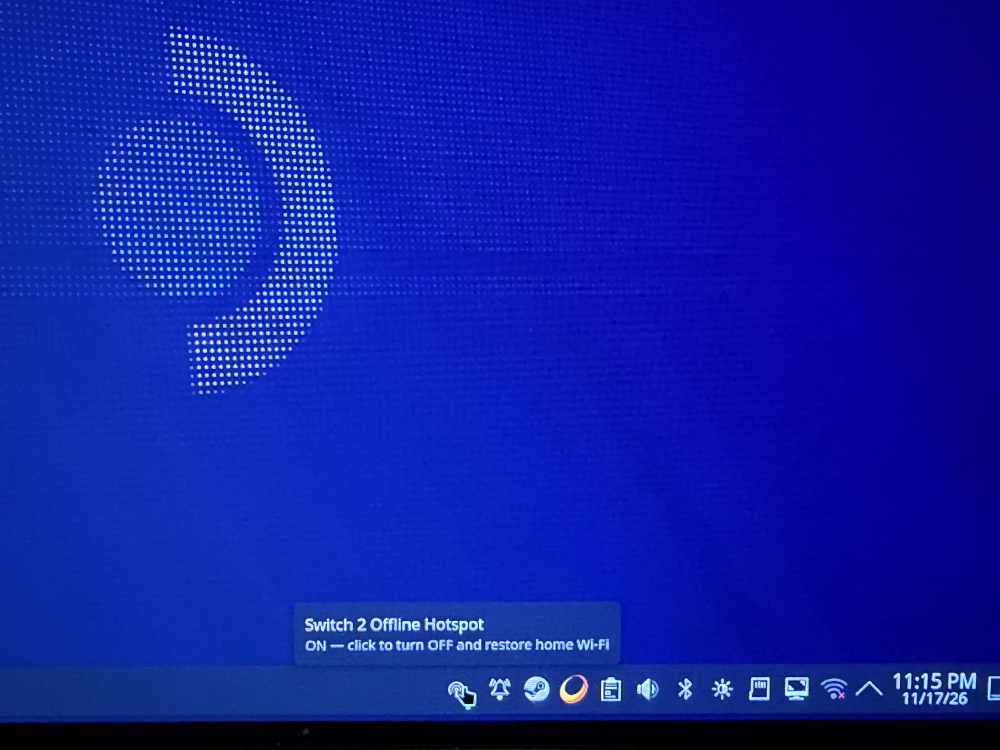

# SwitchNest Hotspot

*Connect locally. Play freely.*

## Turn your PC or laptop into a Nintendo Switch 2 hotspot

**SwitchNest uses your PC or laptop's Wi-Fi adapter to create a local wireless hotspot for your Nintendo Switch 2.** Your computer can remain connected to the internet through a **wired Ethernet/LAN connection** while its Wi-Fi adapter provides a separate connection for the Switch 2.

This lets your computer act as a local hub for:

- **FTP file transfers:** Browse, upload, download, and manage files between your PC and a Switch 2 running a compatible FTP server, such as OunceShell.
- **Game streaming:** Use Sunshine on the computer and a compatible Moonlight client on the Switch 2 to stream your desktop or games over the local Wi-Fi connection.
- **Other local functions:** Access compatible services and tools hosted on the computer without connecting the Switch 2 to the internet.

### How it works

```text
Home router / Internet
         |
    Ethernet (LAN)
         |
  Linux PC / Laptop
  +----------------------+
  | Internet via LAN     |
  | SwitchNest Hotspot   |
  | Wi-Fi adapter (AP)   |
  | FTP / Sunshine host  |
  +----------------------+
         ))) Local Wi-Fi ((( 
                  |
           Nintendo Switch 2
           FTP / Moonlight client
```

**The PC's LAN internet connection is not shared with the Switch 2.** SwitchNest is designed for a local-only Switch 2 network, with IPv4/IPv6 forwarding blocked by its configured firewall rules. The PC can continue using its own wired internet connection. This is not a Nintendo online-service or general internet-sharing hotspot. Actual isolation depends on correct installation and should be verified on the target system.

**Platform:** The current Linux v8.0.0 release targets SteamOS KDE Desktop Mode with an access-point-capable Wi-Fi adapter, NetworkManager, and the existing SwitchNest v7.1 networking backend. Other Linux distributions and Windows are not confirmed supported by this release.


*Historical screenshot: the current menu is named SwitchNest Hotspot.*

**Release status:** Linux v8.0.0 is prepared for public review, with final hardware validation pending. The v8 Control Center requires the separately installed v7.1 hotspot backend.

## Installation — start here

**Install in this order: 1) hotspot backend → 2) taskbar toggle helper → 3) v8 Control Center.** All three scripts are in the same extracted repository folder. The first two use `sudo`; the v8 Control Center installer **must not** use `sudo`.

> **Compatibility:** These instructions target SteamOS in KDE Desktop Mode. You need an access-point-capable Wi-Fi adapter, NetworkManager, and the required system tools. An Ethernet/LAN connection is recommended if you want the computer to retain internet access while Wi-Fi hosts the Switch 2. Do not run the Linux installers on Windows.

### Step 0 — Download and open the project

1. Download the **[Linux v8.0.0 source ZIP](https://github.com/blueshockz47/SwitchNest-Hotspot/archive/refs/heads/release/v8.0.0.zip)**.
2. Extract the ZIP using your file manager.
3. Open the extracted `SwitchNest-Hotspot-release-v8.0.0` folder.
4. Right-click an empty area inside that folder and choose **Open Terminal Here** (Konsole). All commands below are run **from this folder**. If your file manager doesn't offer that action, open Konsole and `cd` to the extracted folder first.

### Step 1 — Install the hotspot backend (required, first)

```bash
sudo bash ./install-switchnest-pico-connectivity-v7.1-password.sh
```

1. Enter your Linux `sudo` password when requested.
2. In the installer menu, choose **1 — Install/update hotspot**.
3. Choose **WPA2-Personal** (recommended) and enter a Wi-Fi password of 8–63 printable ASCII characters. You can choose OPEN mode, but anyone nearby could connect.
4. Follow the prompts until installation completes. If the hotspot is not started automatically, choose **2 — Hotspot ON**.
5. Verify that the Wi-Fi network **`SteamDeck-Switch2`** appears on your Switch 2. Connect using the password you set. Automatic IP/DNS is recommended.

This step configures the Wi-Fi hotspot and its DHCP, DNS, local HTTP connectivity responses, and forwarding firewall rules. **Do not skip it**: installing the v8 GUI alone does not create a hotspot. You may lose your computer's existing Wi-Fi internet connection when its adapter switches into hotspot mode; Ethernet/LAN can remain connected.

### Step 2 — Install the hotspot control helper (required for GUI ON/OFF)

```bash
sudo bash ./install-switchnest-plasma67-panel-toggle.sh
```

This installs the privileged ON/OFF helper used by the v8 Control Center and an **optional** KDE Plasma taskbar widget. Run this **after Step 1**, so the helper can find the installed backend.

You do **not** need to add the widget to the taskbar to use the Control Center. If you want it, right-click the taskbar → **Enter Edit Mode** → **Add Widgets** → **SwitchNest Hotspot Toggle**. The widget is optional, but its installer is needed for v8's hotspot buttons.

### Step 3 — Install SwitchNest v8.0 Control Center (required, last)

Close any old SwitchNest Control Center window. Run this as your **normal desktop user** — **do not use sudo**:

```bash
bash ./install-switchnest-v8.sh
```

The installer creates a user-local Python environment, installs PySide6 (internet needed on first install), runs its included tests, creates a KDE application-menu shortcut, and activates the new release. Allow time for the first installation. At least 2 GiB of free disk space is recommended.

Start the application from the KDE application menu by searching **SwitchNest Control Center**, or run:

```bash
~/.local/share/switchnest/launch
```

### Step 4 — Connect and use your Switch 2

1. In SwitchNest Control Center, open **Overview** or **Network** and check the hotspot status. Turn the hotspot on if needed.
2. Connect the Switch 2 to **`SteamDeck-Switch2`** with the Wi-Fi password chosen in Step 1.
3. For **FTP**, start a compatible FTP server on the Switch 2 (for example, OunceShell). In the Control Center's **Files** page, enter the **IP address and port shown by the FTP server** and click **Connect**. An example from the developer's setup is `10.42.60.99:1337`; your address may differ.
4. For **streaming**, install/configure Sunshine on the Linux host and use a compatible Moonlight client on the Switch 2. See [Sunshine/Moonlight setup](docs/SUNSHINE.md). Sunshine is a separate optional application, not installed by these three scripts.

### Already have the v7.1 backend and helper?

If Steps 1 and 2 are already installed and working, **skip directly to Step 3**. You do not need to reinstall the networking backend just to update the v8 interface.

### Troubleshooting and rollback

| Symptom | What to check |
|---|---|
| Hotspot ON/OFF button fails | Confirm Steps 1 and 2 completed; check polkit authorization and [troubleshooting](docs/TROUBLESHOOTING.md) |
| Switch 2 cannot see Wi-Fi | Check the host Wi-Fi adapter supports AP mode; start hotspot using the v7.1 manager |
| Files page cannot connect | Start FTP on Switch 2 and use its actual IP/port; verify both devices are on the hotspot |
| v8 install fails | Confirm you ran it without `sudo`, have internet for PySide6, and have sufficient free disk space |
| Sunshine isn't available | Install and configure Sunshine separately; see [streaming setup](docs/SUNSHINE.md) |

Check installed versions or roll back to the previous managed Control Center release:

```bash
python3 -m v8.install status
python3 -m v8.install rollback
```

Run these commands from the extracted project folder. Rollback works only if a previous managed release exists. The v8 installer does not change the system hotspot backend.

See [v8 release notes and verification requirements](v8/STABLE.md). **Final hardware validation is pending.** Windows is experimental and not included in this Linux release.

## Control Center Preview

Actual SwitchNest Linux v8.0.0 running in SteamOS KDE Desktop Mode.

### Sunshine / Moonlight


### Files — Nintendo Switch 2 FTP


*Screenshots supplied by the project maintainer. Device and network details shown are illustrative; features depend on the installed v7.1 backend and FTP service.*

## Features

- SSID `SteamDeck-Switch2`; Steam Deck address `10.42.60.1/24`.
- Local DHCP and wildcard DNS, using host dnsmasq when available or a dedicated Podman dnsmasq container.
- Local HTTP responses for the same seven Nintendo connectivity-check hosts used by the Pico bridge.
- An nftables IPv4/IPv6 forwarding block on the hotspot interface.
- Optional WPA2-Personal password or OPEN mode, with password changes available without reinstalling.
- ON/OFF menu, optional boot startup, and best-effort restoration of the previous home Wi-Fi connection.
- Separate Plasma 6.7 panel widget for one-click ON/OFF.
- Optional Sunshine/Moonlight access configured separately; see [streaming setup](docs/SUNSHINE.md).

The connectivity checks receive local responses. This network does not provide internet access or Nintendo online services. The forwarding block does not isolate clients from other clients or from services running on the Steam Deck.

## Compatibility

SteamOS is the tested platform. Bazzite, CachyOS, Arch Linux and other distributions are prospective targets, not confirmed supported platforms.

For compatibility with existing installations, the original SSID `SteamDeck-Switch2`, service names, configuration paths, firewall identifiers and Plasma widget ID are intentionally retained. The new display name does not require a new network profile.

## Requirements

A SteamOS Desktop Mode session, administrator access through `sudo`, NetworkManager with an AP-capable Wi-Fi adapter, and `nmcli`, `nft`, `systemctl`, `flock`, `ss`, `python3`, plus either `dnsmasq` or `podman`. If firewalld is running, the installer uses the dedicated `steamdeck-switch2` zone.

The Podman fallback needs at least 2 GiB free under `/home` and an internet connection for the initial Debian/dnsmasq image build. Later starts use the local image. The installer does not install host packages or change SteamOS read-only settings. A single Wi-Fi adapter normally disconnects from home Wi-Fi when starting the hotspot.

## v7.1 hotspot installer menu reference

Use the **Step 1** command above to open this menu:

| Option | Action |
|---|---|
| 1 | Install/update hotspot, DNS and HTTP responder |
| 2 | Hotspot ON |
| 3 | Hotspot OFF, disable its boot startup, optionally restore previous Wi-Fi |
| 4 | Status and diagnostic commands |
| 5 | Set/change Wi-Fi security: WPA2-Personal or OPEN |
| 6 | Exit the menu |

## Upgrade an already-working v7 to add a password

Run the v7.1 installer above and choose **5**. Choose WPA2-Personal and enter an 8–63 character printable ASCII password twice. Confirm the security change. Connected devices will disconnect; an active hotspot is restarted, with a rollback attempt if startup fails. Reconnect the Switch with the new password; forgetting its saved network may be necessary.

For a password-only upgrade, use **Option 5**. Option 1 updates the wider service/firewall configuration and can reload firewalld. Option 5 preserves the connection UUID, addresses, DNS/HTTP setup and taskbar integration, and backs up the installed manager before replacing it.

The saved manager can be opened later with:

```bash
sudo bash /etc/steamdeck-switch2/manager.sh
```

## Connect Switch 2

Select `SteamDeck-Switch2`, enter the password if configured, and use automatic IP/DNS. Manual settings for a single Switch are:

| Setting | Value |
|---|---|
| IP address | `10.42.60.2` |
| Subnet mask | `255.255.255.0` |
| Gateway | `10.42.60.1` |
| Primary and secondary DNS | `10.42.60.1` |
| Proxy | Off |

DHCP leases use `10.42.60.20`–`10.42.60.100`. Give additional manually configured clients unique addresses outside that range.

## Optional KDE taskbar toggle

The taskbar widget is installed by **Step 2** above. Adding it to the KDE panel is optional.



*Historical screenshot (before rebranding).*

To remove the taskbar widget and its helper, first close the Control Center and run:

```bash
sudo bash ./install-switchnest-plasma67-panel-toggle.sh --remove
```

**Warning:** Removing the helper also disables the v8 Control Center's privileged hotspot ON/OFF controls until Step 2 is reinstalled. The v7.1 hotspot backend remains installed.

## Documentation and checks

- [Sunshine/Moonlight](docs/SUNSHINE.md)
- [Troubleshooting](docs/TROUBLESHOOTING.md)
- [Security and installed files](docs/SECURITY.md)
- [Validation and release readiness](docs/VALIDATION.md)
- [Changelog](CHANGELOG.md)
- [Third-party provenance](THIRD_PARTY_NOTICES.md)

Run local tests without changing Wi-Fi, firewall rules or system services:

```bash
python3 -m unittest discover -s tests -v
```

The installers have been rebranded without changing their network operations. Hardware behavior varies across SteamOS versions, Wi-Fi drivers and client firmware. The v8.0.0 public release requires owner review and hardware checks.

## Credits

The **Pico-compatible DNS/HTTP behavior is based on [CivSwitch-Pico2W-SerialBridge](https://github.com/favas0/CivSwitch-Pico2W-SerialBridge) by favas0**. Thanks to the upstream authors and projects:

| Author / project | Contribution and relationship |
|---|---|
| [favas0 — CivSwitch-Pico2W-SerialBridge](https://github.com/favas0/CivSwitch-Pico2W-SerialBridge) | Pico 2 W port; direct reference for this project’s wildcard DNS and local Nintendo HTTP connectivity-check behavior. |
| [Jack Spence (@jackspence7) — CivSwitch-SerialBridge](https://github.com/jackspence7/CivSwitch-SerialBridge) | Original serial bridge from which the Pico project was ported. |
| [fernando-granco — switch2-homebrew](https://github.com/fernando-granco/switch2-homebrew/tree/main/tools/esp-bridge) | Intermediate connectivity-response source credited by the serial/Pico bridges; its current ESP bridge identifies the responses as adapted from 90DNS. |
| [Ave — 90DNS](https://gitlab.com/a/90dns) | Earlier connectivity-response source, credited by Fernando’s current bridge as Copyright (C) 2018 Ave, GPL-2.0-or-later. |
| [Gezine — CivSwitch](https://github.com/Gezine/CivSwitch) | Console loader/project used by the upstream bridge ecosystem; acknowledged for context, with no loader code bundled in this hotspot installer. |

The upstream Pico build and serial sender also use [Earle Philhower’s Arduino-Pico](https://github.com/earlephilhower/arduino-pico) and [pySerial](https://github.com/pyserial/pyserial). These are upstream Pico dependencies, not requirements of this Steam Deck installer.

Thanks also to the NetworkManager, dnsmasq, Podman/Debian, systemd, nftables, Python, KDE Plasma/polkit, Sunshine and Moonlight projects used by the Steam Deck setup and optional streaming workflow.

Original copyright and license notices are retained. See [THIRD_PARTY_NOTICES.md](THIRD_PARTY_NOTICES.md) for the verified source links, current versus historical license descriptions, and dependency scope.

## License

Project additions and the combined connectivity implementation are provided under GPL-2.0-or-later; see [LICENSE](LICENSE). The panel widget's metadata declares MIT; its component notice is in [licenses/panel-toggle-MIT.txt](licenses/panel-toggle-MIT.txt). Existing Pico/bridge MIT notices and GPL response provenance are retained separately. This project is not affiliated with Valve, Nintendo, KDE, Sunshine or Moonlight.
