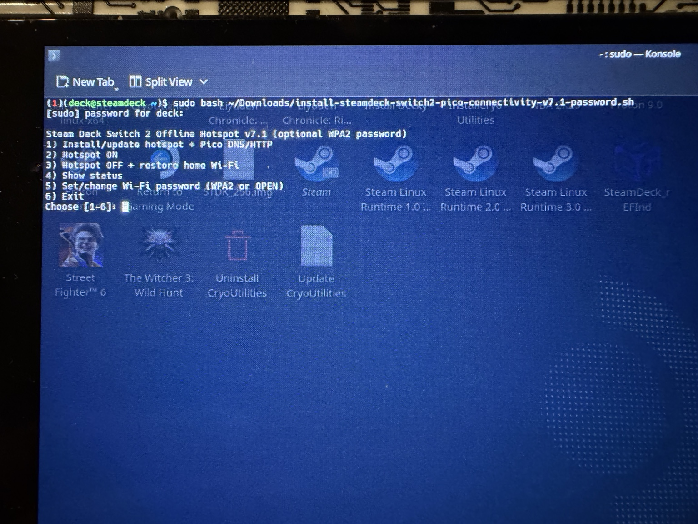
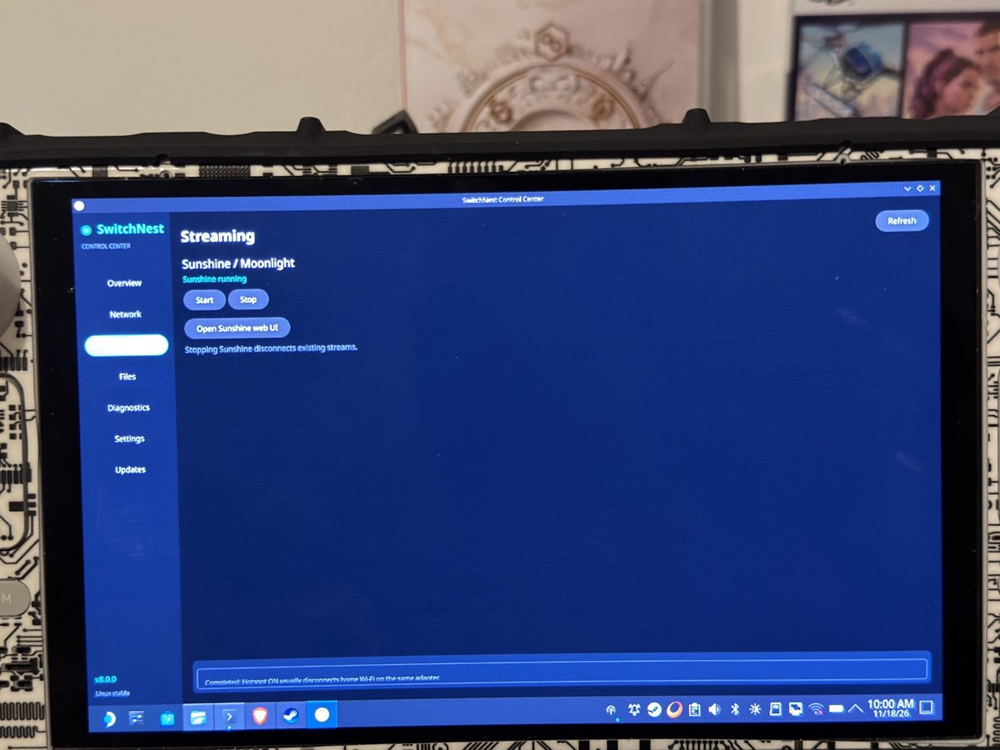
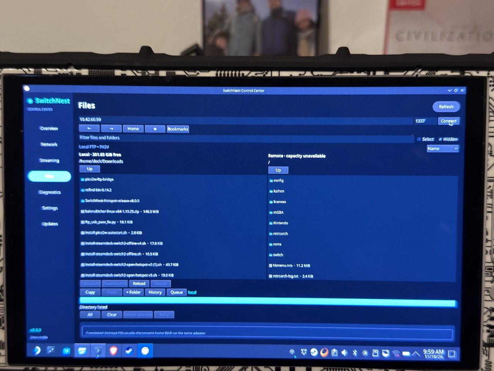

# SwitchNest Hotspot

*Connect locally. Play freely.*

## Turn your PC or laptop into a Nintendo Switch 2 hotspot

**SwitchNest uses your PC or laptop's Wi-Fi adapter to create a local wireless hotspot for your Nintendo Switch 2.** Your computer can remain connected to the internet through a **wired Ethernet/LAN connection** while its Wi-Fi adapter provides a separate connection for the Switch 2.

This lets your computer act as a local hub for:

- **FTP file transfers:** Browse, upload, download, and manage files between your PC and a Switch 2 running a compatible FTP server, such as OunceShell.
- **Game streaming:** Use Sunshine on the computer and a compatible Moonlight client on the Switch 2 to stream your desktop or games over the local Wi-Fi connection.
- **Other local functions:** Access compatible services and tools hosted on the computer without connecting the Switch 2 to the internet.

### How it works

```text
Home router / Internet
         |
    Ethernet (LAN)
         |
  Linux PC / Laptop
  +----------------------+
  | Internet via LAN     |
  | SwitchNest Hotspot   |
  | Wi-Fi adapter (AP)   |
  | FTP / Sunshine host  |
  +----------------------+
         ))) Local Wi-Fi ((( 
                  |
           Nintendo Switch 2
           FTP / Moonlight client
```

**The PC's LAN internet connection is not shared with the Switch 2.** SwitchNest is designed for a local-only Switch 2 network, with IPv4/IPv6 forwarding blocked by its configured firewall rules. The PC can continue using its own wired internet connection. This is not a Nintendo online-service or general internet-sharing hotspot. Actual isolation depends on correct installation and should be verified on the target system.

**Platform:** The current Linux v8.0.0 release targets SteamOS KDE Desktop Mode with an access-point-capable Wi-Fi adapter, NetworkManager, and the existing SwitchNest v7.1 networking backend. Other Linux distributions and Windows are not confirmed supported by this release.



*Historical screenshot: the current menu is named SwitchNest Hotspot.*

**Release status:** Linux v8.0.0 is prepared for public review, with final hardware validation pending. The v8 Control Center requires the separately installed v7.1 hotspot backend.

## Linux v8.0.0 Control Center

The v8 desktop Control Center is a user-local PySide6 application for an **existing v7.1 SteamOS hotspot installation**. It does not install the networking backend on its own.

Install the hotspot backend first using the v7.1 instructions below. Then run the v8 installer as your **normal desktop user**:

```bash
bash install-switchnest-v8.sh
~/.local/share/switchnest/launch
```

The v8 UI provides hotspot ON/OFF, read-only diagnostics, Sunshine controls, an FTP file manager with recursive folder operations, an opt-in KDE Desktop autostart setting, and a manual GitHub Releases update checker. The installer preserves a previous managed release for rollback:

```bash
python3 -m v8.install status
python3 -m v8.install rollback
```

See [v8 release notes and verification requirements](v8/STABLE.md). **Public hardware validation is still pending; do not treat the isolation indicator as a firewall audit.** Windows is experimental and is not included in this Linux release.

## Control Center Preview

Actual SwitchNest Linux v8.0.0 running in SteamOS KDE Desktop Mode.

### Sunshine / Moonlight



### Files — Nintendo Switch 2 FTP



*Screenshots supplied by the project maintainer. Device and network details shown are illustrative; features depend on the installed v7.1 backend and FTP service.*

## Features

- SSID `SteamDeck-Switch2`; Steam Deck address `10.42.60.1/24`.
- Local DHCP and wildcard DNS, using host dnsmasq when available or a dedicated Podman dnsmasq container.
- Local HTTP responses for the same seven Nintendo connectivity-check hosts used by the Pico bridge.
- An nftables IPv4/IPv6 forwarding block on the hotspot interface.
- Optional WPA2-Personal password or OPEN mode, with password changes available without reinstalling.
- ON/OFF menu, optional boot startup, and best-effort restoration of the previous home Wi-Fi connection.
- Separate Plasma 6.7 panel widget for one-click ON/OFF.
- Optional Sunshine/Moonlight access configured separately; see [streaming setup](docs/SUNSHINE.md).

The connectivity checks receive local responses. This network does not provide internet access or Nintendo online services. The forwarding block does not isolate clients from other clients or from services running on the Steam Deck.

## Compatibility

SteamOS is the tested platform. Bazzite, CachyOS, Arch Linux and other distributions are prospective targets, not confirmed supported platforms.

For compatibility with existing installations, the original SSID `SteamDeck-Switch2`, service names, configuration paths, firewall identifiers and Plasma widget ID are intentionally retained. The new display name does not require a new network profile.

## Requirements

A SteamOS Desktop Mode session, administrator access through `sudo`, NetworkManager with an AP-capable Wi-Fi adapter, and `nmcli`, `nft`, `systemctl`, `flock`, `ss`, `python3`, plus either `dnsmasq` or `podman`. If firewalld is running, the installer uses the dedicated `steamdeck-switch2` zone.

The Podman fallback needs at least 2 GiB free under `/home` and an internet connection for the initial Debian/dnsmasq image build. Later starts use the local image. The installer does not install host packages or change SteamOS read-only settings. A single Wi-Fi adapter normally disconnects from home Wi-Fi when starting the hotspot.

## Install on a new Steam Deck

Download or clone this repository, open Konsole in its folder, and run:

```bash
sudo bash ./install-switchnest-pico-connectivity-v7.1-password.sh
```

Choose **1**, select WPA2-Personal or OPEN, and follow the prompts. Choose **2** to start the hotspot if you did not start it during installation.

| Option | Action |
|---|---|
| 1 | Install/update hotspot, DNS and HTTP responder |
| 2 | Hotspot ON |
| 3 | Hotspot OFF, disable its boot startup, optionally restore previous Wi-Fi |
| 4 | Status and diagnostic commands |
| 5 | Set/change Wi-Fi security: WPA2-Personal or OPEN |
| 6 | Exit the menu |

## Upgrade an already-working v7 to add a password

Run the v7.1 installer above and choose **5**. Choose WPA2-Personal and enter an 8–63 character printable ASCII password twice. Confirm the security change. Connected devices will disconnect; an active hotspot is restarted, with a rollback attempt if startup fails. Reconnect the Switch with the new password; forgetting its saved network may be necessary.

For a password-only upgrade, use **Option 5**. Option 1 updates the wider service/firewall configuration and can reload firewalld. Option 5 preserves the connection UUID, addresses, DNS/HTTP setup and taskbar integration, and backs up the installed manager before replacing it.

The saved manager can be opened later with:

```bash
sudo bash /etc/steamdeck-switch2/manager.sh
```

## Connect Switch 2

Select `SteamDeck-Switch2`, enter the password if configured, and use automatic IP/DNS. Manual settings for a single Switch are:

| Setting | Value |
|---|---|
| IP address | `10.42.60.2` |
| Subnet mask | `255.255.255.0` |
| Gateway | `10.42.60.1` |
| Primary and secondary DNS | `10.42.60.1` |
| Proxy | Off |

DHCP leases use `10.42.60.20`–`10.42.60.100`. Give additional manually configured clients unique addresses outside that range.

## Add the taskbar toggle


*Historical screenshot (before rebranding). The taskbar toggle in use: ON — click to turn OFF and restore home Wi-Fi.*

After the hotspot is installed, run as your normal desktop user through sudo:

```bash
sudo bash ./install-switchnest-plasma67-panel-toggle.sh
```

Right-click the taskbar, choose **Enter Edit Mode → Add Widgets**, find **SwitchNest Hotspot Toggle**, and drag it onto the panel. If it does not appear, sign out and back into Desktop Mode.

- OFF → click: starts the hotspot using the same ON operation as menu Option 2.
- ON → click: stops it and attempts to restore the previous Wi-Fi, matching Option 3 with its prompts accepted.

This is a separate widget. It does not replace the compiled KDE network applet. Its polkit rule authorizes the installing, active local desktop user to run only the fixed helper, whose accepted actions are ON/OFF/toggle. See [security notes](docs/SECURITY.md).

To remove the widget, remove it from the panel and run:

```bash
sudo bash ./install-switchnest-plasma67-panel-toggle.sh --remove
```

The hotspot remains installed. To stop the hotspot and disable boot startup, choose Option 3 in the manager.

## Documentation and checks

- [Sunshine/Moonlight](docs/SUNSHINE.md)
- [Troubleshooting](docs/TROUBLESHOOTING.md)
- [Security and installed files](docs/SECURITY.md)
- [Validation and release readiness](docs/VALIDATION.md)
- [Changelog](CHANGELOG.md)
- [Third-party provenance](THIRD_PARTY_NOTICES.md)

Run local tests without changing Wi-Fi, firewall rules or system services:

```bash
python3 -m unittest discover -s tests -v
```

The installers have been rebranded without changing their network operations. Hardware behavior varies across SteamOS versions, Wi-Fi drivers and client firmware. The v8.0.0 public release requires owner review and hardware checks.

## Credits

The **Pico-compatible DNS/HTTP behavior is based on [CivSwitch-Pico2W-SerialBridge](https://github.com/favas0/CivSwitch-Pico2W-SerialBridge) by favas0**. Thanks to the upstream authors and projects:

| Author / project | Contribution and relationship |
|---|---|
| [favas0 — CivSwitch-Pico2W-SerialBridge](https://github.com/favas0/CivSwitch-Pico2W-SerialBridge) | Pico 2 W port; direct reference for this project’s wildcard DNS and local Nintendo HTTP connectivity-check behavior. |
| [Jack Spence (@jackspence7) — CivSwitch-SerialBridge](https://github.com/jackspence7/CivSwitch-SerialBridge) | Original serial bridge from which the Pico project was ported. |
| [fernando-granco — switch2-homebrew](https://github.com/fernando-granco/switch2-homebrew/tree/main/tools/esp-bridge) | Intermediate connectivity-response source credited by the serial/Pico bridges; its current ESP bridge identifies the responses as adapted from 90DNS. |
| [Ave — 90DNS](https://gitlab.com/a/90dns) | Earlier connectivity-response source, credited by Fernando’s current bridge as Copyright (C) 2018 Ave, GPL-2.0-or-later. |
| [Gezine — CivSwitch](https://github.com/Gezine/CivSwitch) | Console loader/project used by the upstream bridge ecosystem; acknowledged for context, with no loader code bundled in this hotspot installer. |

The upstream Pico build and serial sender also use [Earle Philhower’s Arduino-Pico](https://github.com/earlephilhower/arduino-pico) and [pySerial](https://github.com/pyserial/pyserial). These are upstream Pico dependencies, not requirements of this Steam Deck installer.

Thanks also to the NetworkManager, dnsmasq, Podman/Debian, systemd, nftables, Python, KDE Plasma/polkit, Sunshine and Moonlight projects used by the Steam Deck setup and optional streaming workflow.

Original copyright and license notices are retained. See [THIRD_PARTY_NOTICES.md](THIRD_PARTY_NOTICES.md) for the verified source links, current versus historical license descriptions, and dependency scope.

## License

Project additions and the combined connectivity implementation are provided under GPL-2.0-or-later; see [LICENSE](LICENSE). The panel widget's metadata declares MIT; its component notice is in [licenses/panel-toggle-MIT.txt](licenses/panel-toggle-MIT.txt). Existing Pico/bridge MIT notices and GPL response provenance are retained separately. This project is not affiliated with Valve, Nintendo, KDE, Sunshine or Moonlight.
