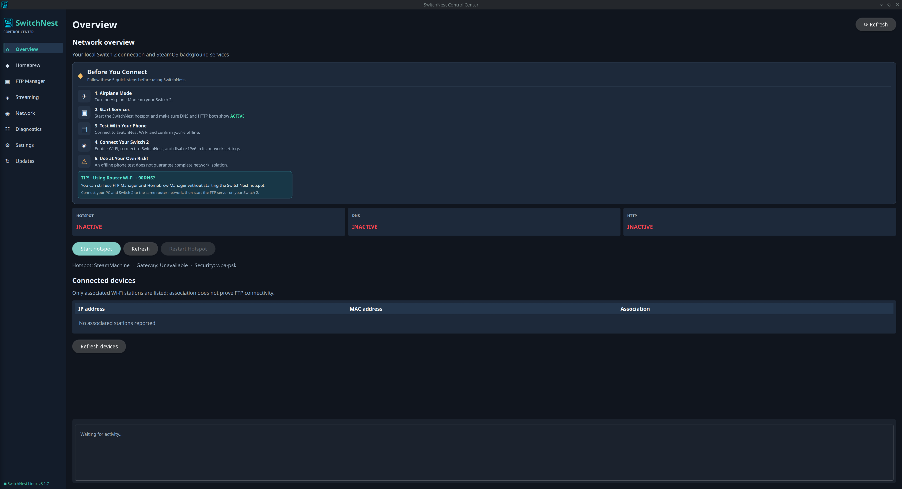
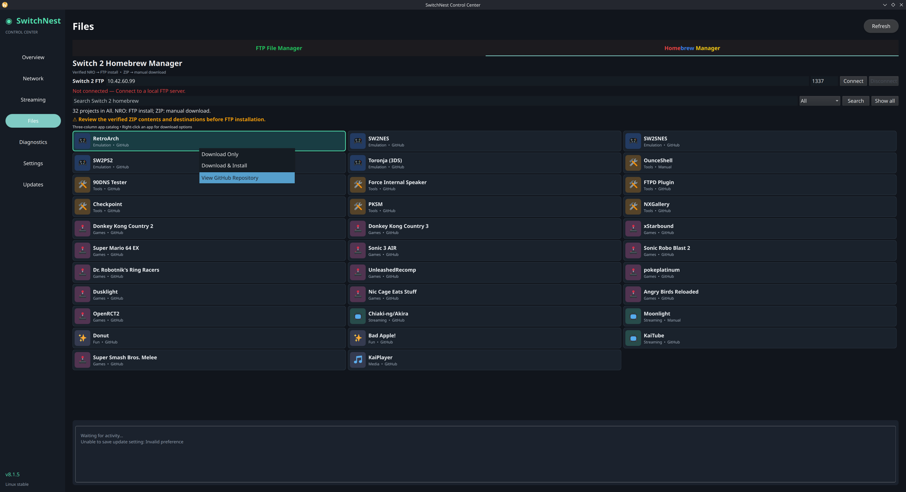

# SwitchNest (Offline Hotspot + Homebrew Manager)

**An offline Nintendo Switch 2 Wi-Fi hotspot, FTP File Manager, and Homebrew Manager for SteamOS.**

*Connect locally. Play freely.*

[](https://github.com/blueshockz47/SwitchNest-Hotspot/releases/tag/v8.1.5)  [](LICENSE)

**[Download v8.1.5 for Linux (ZIP)](https://github.com/blueshockz47/SwitchNest-Hotspot/releases/download/v8.1.5/SwitchNest-Hotspot-Linux-v8.1.5.zip)** · [Installation](#quick-install-on-steamos) · [Screenshots](#screenshots--v815) · [Release notes](https://github.com/blueshockz47/SwitchNest-Hotspot/releases/tag/v8.1.5) · [Report a bug](https://github.com/blueshockz47/SwitchNest-Hotspot/issues)

SwitchNest lets you connect a Nintendo Switch 2 directly to your SteamOS PC over a **local-only Wi-Fi hotspot**, manage files through FTP, browse homebrew releases, and control Sunshine streaming. **The offline hotspot can start without Ethernet/LAN or an internet connection** once its required components are installed and your Wi-Fi adapter supports access-point mode.

**You do not need to use the SwitchNest hotspot for FTP or Homebrew Manager.** If your PC and Switch 2 are on the **same reachable local network** (such as your home router's Wi-Fi/LAN), those tools can connect directly to a compatible FTP server running on the Switch 2. This also works when the Switch 2 uses **90DNS**, provided its network settings still allow local communication and the FTP server is reachable. GitHub downloads still require internet access on the PC.

> **Important:** The SwitchNest hotspot is designed not to share the PC's internet connection with the console. Verify firewall isolation independently; an *Isolation: Unverified* status is not proof of isolation. SwitchNest does not jailbreak the console or install kaiHEN.

## What can SwitchNest do?

| Feature | Description |
| --- | --- |
| **Offline Wi-Fi hotspot** | Connect your Switch 2 locally without sharing internet; Ethernet/LAN is **not required** to start the hotspot. |
| **FTP File Manager** | Transfer files with a compatible Switch 2 FTP server over the SwitchNest hotspot **or any reachable shared local network**, including setups using 90DNS. |
| **Switch 2 Homebrew Manager** | Browse curated homebrew releases, download eligible files, and install supported verified NRO files over FTP with confirmation; **the SwitchNest hotspot is optional**. |
| **Sunshine / Moonlight** | Start or stop an existing Sunshine service and open its web interface for local game streaming. |
| **Wi-Fi settings** | Manage the hotspot SSID, WPA2 password, channel, and saved presets using the existing backend. |
| **Status and recovery** | View hotspot/DNS status, connected Wi-Fi stations, diagnostics, and restart controls. |
| **Updates and rollback** | Update the Control Center and return to a previous managed installation when available. |

**Homebrew safety:** Catalog entries are not automatically approved for installation. A compatible release with a verifiable SHA-256 digest is required for supported downloads. Some apps need additional setup or manual installation. ZIP files are download-only in the stable Homebrew Manager.

## Screenshots — v8.1.5

**Overview — hotspot status and network diagnostics**



| Homebrew Manager | FTP File Manager |
| --- | --- |
|  |  |
| Browse homebrew releases and supported installation options | Transfer files to and from a compatible Switch 2 FTP server |

| Wi-Fi Settings | Streaming |
| --- | --- |
|  |  |
| Configure hotspot Wi-Fi and recovery controls | Manage a separately installed Sunshine server |

## Requirements

- **SteamOS with KDE Desktop Mode** and an access-point-capable Wi-Fi adapter.
- **NetworkManager** and the Linux tools required by the hotspot backend.
- **Administrator access** for backend/helper installation; install the Control Center as your regular user.
- **Ethernet/LAN is optional.** The offline hotspot can run without a wired connection or internet access after installation. Ethernet is useful only if you want the PC online at the same time; an adapter cannot normally act as both a Wi-Fi client and access point unless the hardware and driver support it.
- Internet access for initial downloads/dependency installation and for GitHub homebrew downloads; **not required to start the installed offline hotspot**.
- Approximately **2 GiB of free space** recommended for installation; more may be needed for downloaded homebrew.

Other Linux distributions and Windows are **not confirmed supported** by this Linux release.

## Quick install on SteamOS

Install in this order: **hotspot backend → control helper → Control Center**. If you already have a working v7.1 backend and helper, skip to Step 3. **No Ethernet connection is required to run the offline hotspot.**

### 1. Download the project

Download the **[SwitchNest Hotspot Linux v8.1.5 ZIP](https://github.com/blueshockz47/SwitchNest-Hotspot/releases/download/v8.1.5/SwitchNest-Hotspot-Linux-v8.1.5.zip)** and extract it. Use this stable release package rather than the development branch ZIP.

Open **Konsole** inside the extracted project folder. Run the commands below from that folder.

### 2. Install the hotspot backend and helper

Install the v7.1 hotspot backend:

```bash
sudo bash ./install-switchnest-pico-connectivity-v7.1-password.sh
```

Choose **Install/update hotspot**, then configure **WPA2-Personal** and your Wi-Fi password. The default SSID on a fresh backend installation is `SteamDeck-Switch2`; existing installations may use a different name.

Install the Control Center's privileged ON/OFF helper:

```bash
sudo bash ./install-switchnest-plasma67-panel-toggle.sh
```

The KDE taskbar toggle is optional, but this helper is required for the GUI's privileged hotspot controls.

### 3. Install the Control Center

**Do not use `sudo` for this command.**

```bash
bash ./install-switchnest-v8.sh
```

When installation finishes, open **SwitchNest Control Center** from the KDE application menu, or run:

```bash
~/.local/share/switchnest/launch
```

### 4. Connect your Nintendo Switch 2

1. In SwitchNest, open **Overview** and start the hotspot if necessary.
2. On the Switch 2, join the Wi-Fi network you configured during installation.
3. Use **automatic IP/DNS** unless your setup specifically requires manual network settings.
4. Confirm that the device appears under **Connected Wi-Fi stations**.

The hotspot is designed for local connectivity. It does not provide Nintendo online services.

## Use FTP and Homebrew Manager without the SwitchNest hotspot

You can leave the SwitchNest offline hotspot **OFF** and use your existing home network instead:

1. Connect your PC and Switch 2 to the **same local network** (for example, PC on router Ethernet and Switch 2 on router Wi-Fi, or both on the same Wi-Fi).
2. Start a compatible **FTP server on the Switch 2** and note its IP address and port.
3. Open SwitchNest's **FTP File Manager** or **Homebrew Manager**, enter that IP and port, and connect. For Homebrew Manager, choose a supported NRO installation workflow when available.
4. If the Switch 2 uses **90DNS**, you can keep it configured: DNS filtering does not inherently prevent local FTP traffic. Make sure the router, client isolation, firewall, and console network configuration permit devices to reach each other.

**No SwitchNest hotspot or Ethernet cable is required for these file-management features.** The PC still needs internet access to fetch new GitHub homebrew releases, and the console must have a compatible FTP server running. A 90DNS configuration is **not** a guarantee of blocking all Nintendo services or of network security.

## How to use the Homebrew Manager

1. Start SwitchNest and open **Files → Homebrew Manager**.
2. Use **Search** or the category filter to find an app.
3. **Right-click** an app card. Choose **View GitHub Repository**, **Download Only**, or **Download & Install**, depending on the available release and app requirements.
4. For **Download Only**, select an eligible verified release file and follow the project's installation instructions.
5. For **Download & Install**, first start a compatible FTP server on your Switch 2, enter the IP address and port shown on the console, and select **Connect**.
6. Choose an eligible **verified single-file NRO** release, review the destination and confirmation prompt, then approve the FTP transfer. Supported NRO installs target `/switch/`.
7. If an app requires a ZIP, plugin, extra files, or special setup, use the project's manual instructions instead of assuming a one-click installation will work.

**Example FTP connection:** `10.42.60.99` on port `1337` (from the maintainer's setup). Your console's IP and FTP port may be different.

> **No automatic homebrew installation:** The stable v8.1.5 Homebrew Manager is a curated catalog and verified-download workflow. Automatic GitHub/Reddit release monitoring is planned for **v8.1.6** and is **not** included in v8.1.5.

## How to use FTP and streaming

**FTP:** The SwitchNest hotspot is optional: use any reachable shared local network, including a network where the Switch 2 has 90DNS configured. Launch a compatible FTP server on the Switch 2 (for example, OunceShell), open **Files → FTP File Manager**, enter the server IP and port, and click **Connect**. Browse the local and remote panels to manage transfers.

**Streaming:** Install and configure [Sunshine](https://github.com/LizardByte/Sunshine) on your PC and a compatible Moonlight client on your Switch 2. Open SwitchNest's **Streaming** page to control Sunshine. [Detailed streaming guide](docs/SUNSHINE.md).

## Updating and troubleshooting

Use the **Updates** page for supported Control Center updates. To inspect or roll back a managed installation from an extracted repository folder:

```bash
python3 -m v8.install status
python3 -m v8.install rollback
```

Rollback requires a previous managed release. The Control Center installer does not reinstall or replace your working hotspot backend.

| Problem | What to check |
| --- | --- |
| Switch 2 cannot see the hotspot | Check Wi-Fi adapter AP support, hotspot status, and configured SSID. |
| FTP won't connect | Start the FTP server on the console and confirm its actual IP and port. |
| No homebrew install option | The app may be manual-only or lack an eligible SHA-256-verified NRO release. |
| Sunshine is unavailable | Install/configure Sunshine separately; it is not bundled with SwitchNest. |
| **Invalid preference** when saving maximized startup | Known v8.1.5 issue; a fix is included in the v8.1.6 development work. |
| **Isolation: Unverified** | Check firewall forwarding rules and verify isolation independently. |

For additional help, see [Troubleshooting](docs/TROUBLESHOOTING.md), [Security](docs/SECURITY.md), and [Validation](docs/VALIDATION.md).

## Development status

- **v8.1.5 — stable:** Hotspot Control Center, FTP, Homebrew Manager, streaming controls, and settings.
- **v8.1.6 — in development:** Maximized startup preference fix and six-hour GitHub/Reddit homebrew discovery, with notifications and user-confirmed installation. See [PR #24](https://github.com/blueshockz47/SwitchNest-Hotspot/pull/24).

## SwitchNest Offline Hotspot vs. a normal hotspot

Both create a Wi-Fi network, but they are designed for different purposes:

| | **SwitchNest Offline Hotspot** | **Normal internet hotspot** |
| --- | --- | --- |
| **Main purpose** | Local connection between your Nintendo Switch 2 and SteamOS PC | Share an internet connection with other devices |
| **Internet on the Switch 2** | **Not shared by design**; Nintendo online services are not provided | Usually available through the host's internet connection |
| **Internet on the PC** | **Not required**; the hotspot starts without Ethernet/LAN. Ethernet can keep the PC online separately | The PC typically stays online and forwards that connection to clients |
| **Local file transfers** | Built-in FTP File Manager for a compatible FTP server running on the Switch 2 | Possible only if you set up suitable file-transfer software separately |
| **Homebrew tools** | Includes a curated Homebrew Manager with supported download and confirmed FTP installation workflows | Not included |
| **Streaming controls** | Integrates controls for an independently installed Sunshine server | Not included by default |

**Why use SwitchNest?** Its FTP and Homebrew Manager also work without the SwitchNest hotspot on any reachable shared local network (including with 90DNS configured on the console). The optional offline hotspot provides a dedicated local Wi-Fi link for Switch 2 file management, homebrew workflows, and compatible local streaming **without intentionally sharing the PC's internet connection with the console**.

**Important:** “Offline” describes SwitchNest's intended network configuration, not a guarantee of isolation. Confirm your firewall and forwarding rules before relying on the hotspot to keep the Switch 2 offline. SwitchNest does not jailbreak the console, and the Homebrew Manager does not replace the console-side homebrew prerequisites.

## Credits

SwitchNest's Pico-compatible local DNS/HTTP connectivity responses are based on work from [favas0's CivSwitch-Pico2W-SerialBridge](https://github.com/favas0/CivSwitch-Pico2W-SerialBridge), [Jack Spence's CivSwitch-SerialBridge](https://github.com/jackspence7/CivSwitch-SerialBridge), and related [Switch 2 bridge references](https://github.com/fernando-granco/switch2-homebrew). The project also acknowledges [90DNS](https://gitlab.com/a/90dns) and [Gezine's CivSwitch](https://github.com/Gezine/CivSwitch).

Thanks to the upstream authors and maintainers of NetworkManager, dnsmasq, Podman, KDE Plasma, Python/PySide6, Sunshine, Moonlight, and the homebrew projects linked from the catalog. See [Third-party notices](THIRD_PARTY_NOTICES.md) for further provenance and license information.
